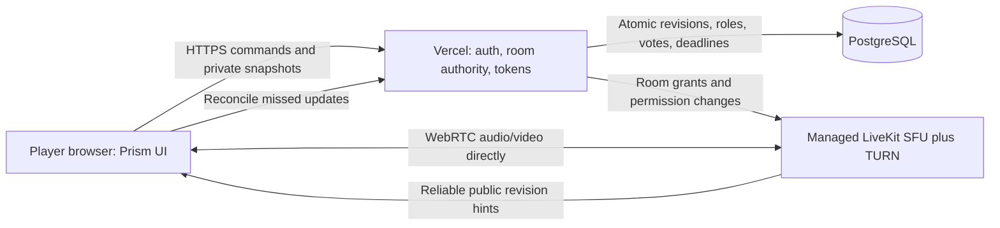

# Mafia Online: architecture and delivery plan

Status: **planning only**, 11 November 2026. The platform ships a manifest, an
original icon, and a Coming soon preview. There are no Mafia game rules, room
handlers, camera requests, video subscriptions, production media credentials,
or infrastructure deployments in this change.

The capacity target is **20 people in one private room, including the host**.
A non-playing moderator consumes one of those 20 places. An additional host or
spectators would require a new capacity calculation. The proposed game supports
6–20 people with a playing host; non-playing-moderator mode has its own minimum
player validation. Session planning assumption: 60 minutes.

## Product references and chosen direction

| Reference | Useful behavior | Decision |
| --- | --- | --- |
| [Mafia Online](https://www.mafia-online.club/en) | Integrated video table, secret roles, timers, voting, host controls | Keep discussion, personal role, and voting in one app; do not reproduce its artwork or code. |
| [Mafiagg FAQ](https://mafiagg.com/en/faq) | Voice-first rooms; role complexity grows with group size | Camera optional; make audio-only a supported first-class mode. |
| [Mafia Call rulebook](https://muqecha.studio/mafia/) | Private join link/code; explicit day/night actions | Clear phase cues and a reconnectable private room. This is a product reference, not the exact ruleset we will implement. |
| [LiveKit SFU](https://docs.livekit.io/reference/internals/livekit-sfu/) | Selective forwarding rather than peer mesh | Use a managed SFU for media; keep the application on Vercel. No retired cluster dependency. |
| [LiveKit media options](https://docs.livekit.io/transport/media/advanced/) and [track subscriptions](https://docs.livekit.io/transport/media/subscribe/) | Simulcast, adaptive subscriptions, offscreen suppression | Two bounded quality layers and a speaker plus thumbnails layout. |
| [LiveKit grants](https://docs.livekit.io/frontends/reference/tokens-grants/) | Scoped participant/source permissions | Issue short-lived room-scoped credentials on the server, never broad administration tokens to players. |
| [Vercel WebSockets GA, 20 October 2026](https://vercel.com/changelog/websocket-support-is-now-generally-available) and [connection lifecycle](https://vercel.com/kb/guide/real-time-chat-websockets) | WebSockets are now supported; function lifetime still matters | Do not repeat the obsolete blanket claim that Vercel cannot support WebSockets. The proposed design does not require hosting a media SFU in a Function. |

References were reviewed on 11 November 2026. They establish integration patterns,
not proof of production capacity or a license to copy another game's assets.

## Service boundaries



- Vercel serves the shell, API, server-authoritative reducer, sanitized projections,
  capability checks, media grants, and webhook validation. It never proxies video
  bytes or stores live media in PostgreSQL. No long-lived in-memory room authority.
- PostgreSQL owns a versioned room state, membership, private roles, votes,
  deadlines, idempotency keys, and bounded audit history. Updates acquire the room
  row lock and compare revision/phase before applying an action. Keep room rules
  isolated in `games/mafia` when implementation starts; reuse the generic room
  contracts and capability infrastructure rather than the removed Radar module.
- A managed LiveKit project supplies the SFU, signaling and TURN. Prefer an EU
  region near the players; verify data region, plan limits and current pricing at
  provisioning. No project, paid plan, server or cluster is provisioned now.
- Commands remain authenticated HTTPS. Public revision-only hints may use the
  SFU's reliable data channel, sent by the server. Clients fetch their own private
  projection after a hint, on reconnect, and every 30 seconds as reconciliation.
  Data messages are hints, never trusted game state or the only record of a vote.
- When media is disabled, the app must still deliver state updates: use a data-only
  SFU connection or a verified Vercel SSE/WebSocket adapter with cross-instance
  delivery. Decide and test that adapter before implementation; do not assume an
  arbitrary App Router route automatically supports WebSocket upgrades.
- Phase deadlines persist as UTC times. No `setTimeout` on one serverless instance
  decides the game. A due command or scheduled authenticated job resolves the
  deadline transactionally; clients display countdowns from the server time.

## Private room and controls contract

| Area | Planned behavior |
| --- | --- |
| Entry | Cryptographically random invite code/link; optional password; rate-limited create/join; 20-place transaction-safe cap; invite code is not an authentication credential. |
| Identity | Opaque member ID plus signed capability; bounded display name; no name-based authorization. Rejoin restores the same seat using a rotated capability. |
| Lobby | Roster, host, readiness, rules preset, camera/microphone preview, permission errors, device selection and an audio-only option. No camera capture before explicit action. |
| Host | Admit/lock room, kick/ban, mute, speaker queue, pause timers, select next host and end game. Native browser prompts remain user-owned: hosts cannot turn another person's camera or microphone on. |
| Start | Ready check, valid role preset and participant count; freeze settings and role visibility mode before a cryptographically secure deal. |
| Table | Stable seat order; one active speaker; visible speaking/mute/camera/reconnect status; accessible text phase labels and server deadline. No decoration that competes with faces and voting. |
| Personal role | Private card revealed only to that member. The playing host gets the same limited projection as everyone else. Explicit non-playing moderator mode may have an all-role view; it cannot be enabled mid-game. |
| Voting | Clear eligibility and remaining time, selection confirmation, one vote per eligible member, replace-before-lock policy, explicit tie/runoff rules, server acknowledgement. |
| Leave/rejoin | Local preview explains camera/mic state. A reconnect restores the current phase and submitted actions. No automatic new seat and no duplicated vote. |
| Access | Lobby lock and bans enforced both by room APIs and media tokens; a removed participant loses publication/subscription rights and cannot reuse an old grant to return. |
| Recovery | Scoped loading stages for joining, media connection, permission updates and actions. Cancel/retry where safe; stale results ignored; input preserved. Media can degrade independently while game controls remain available. |

Proposed phase machine:
`lobby → ready-check → role-reveal → night → discussion → nominations → vote →
runoff/reveal → night`, with terminal `game-over`. Exact role balance and tie,
disconnect, abstention, simultaneous-action and win-condition rules must be
written and tested before game code. Initial roles: citizen, mafia, detective,
doctor; additional roles are explicitly out of the first release.

## Media policy and private phases

- Camera capture ceiling: **640×360 at 15 fps**, VP8 for broad compatibility;
  start with a **350 kbps** main layer and **320×180 at 10 fps / 80 kbps** thumbnail
  layer. Validate the codec and Safari fallback on actual devices before release.
- Mono Opus: **24 kbps** target, DTX, echo cancellation, noise suppression. Budget
  all 20 audio publishers even if the UI permits fewer simultaneous speakers.
- Desktop: one remote speaker at 360p plus 18 remote thumbnails; own preview is
  local. Mobile: one remote speaker plus up to five visible thumbnails, paging
  the remaining seats. Hidden/background tiles unsubscribe; no invisible 20-video
  decoder grid. Audio-only fallback preserves turn and vote controls.
- Use adaptive subscriptions, simulcast and dynacast. No screen sharing, recording,
  file transfer, livestream audience, or automatic camera enabling in v1.
- These are cooperative-client encode limits, **not an assertion that SFU token
  grants can enforce camera dimensions**. Track source/count grants, observed
  bandwidth, abusive publishers and room policy also need server enforcement.
  Prove the limits in client `getStats` and SFU telemetry under load; disconnect
  clients that exceed the allowed publication envelope. Avoid claiming a hard
  decoded resolution limit without an enforcement mechanism.
- Night: stop/unpublish cameras and microphones for everyone, with server-side
  publish permissions removed. Private actions go through role-authorized HTTPS.
  V1 has **no separate mafia video/voice subgroup**: subscription membership,
  speaking indicators and track events could otherwise disclose hidden roles.
- Eliminated players can remain at the table as read-only room members but cannot
  publish or vote. Apply SFU permission changes and unpublish active tracks;
  disabling a button is insufficient. No extra observer places in the 20-person
  envelope. Day-start permissions are restored by the server after phase commit.
- Permission transitions need a fail-closed handshake: revoke, confirm, then
  announce private-phase entry; if revocation fails, pause the transition and
  show recovery. Never assume database phase changes instantly revoke media.
- Room-scoped, short-lived grants permit camera/mic sources only when phase and
  membership allow them. No roles, team names or private targets in room metadata,
  participant identities, generic data broadcasts, analytics or error logs.

## Calculated 20-person load

Reproduce with `node scripts/mafia-capacity.mjs`; the checked-in output is
[mafia-capacity.json](measurements/mafia-capacity.json). Decimal Mbps/GB; 15%
transport overhead and 25% additional provision headroom. These are declared
planning assumptions, not measured browser performance.

| Case | Download per client | SFU egress per room | Egress with headroom | Egress per 60-min room |
| --- | ---: | ---: | ---: | ---: |
| Desktop: 1 speaker + 18 thumbnails | 2.583 Mbps | 51.658 Mbps | 64.572 Mbps | 23.246 GB |
| Mobile: 1 speaker + 5 thumbnails | 1.387 Mbps | 27.738 Mbps | 34.673 Mbps | 12.482 GB |
| Stress ceiling: all 19 remote cameras at 360p | 8.172 Mbps | 163.438 Mbps | 204.298 Mbps | 73.547 GB |
| Audio-only, all 19 remote microphones budgeted | 0.524 Mbps | 10.488 Mbps | 13.110 Mbps | 4.720 GB |

Each client's two-layer upload envelope is **0.522 Mbps** including overhead;
SFU ingress is **10.442 Mbps** for the room. The mesh alternative needs 190 peer
pairs and approximately **8.172 Mbps upload per player** for the same main-layer
assumptions. This is why an SFU is the initial choice.

20 people × 60 minutes = **1,200 participant-minutes per room-hour**. Price against
[the current managed plan](https://livekit.com/pricing), included allowances and
region; no fixed quote is assumed. Recording is excluded. TURN relaying can add
separate relay traffic/cost; re-run with a measured relay ratio (test 0%, 25%,
100%) and verify which directions the selected provider bills. Ten simultaneous
rooms scale the media envelope roughly tenfold; do not infer account quota or
CPU capacity from one room.

Control-plane assumption: 12 commands/minute, each prompting 20 private 8 KiB
snapshot fetches, plus 30-second reconciliation: **4.87 requests/second per room**,
including commands, about **0.306 Mbps** snapshot payload. This excludes HTTP/TLS
and database overhead. A role reveal/deal may burst all 20 snapshots at once;
bound payload size, use pooled DB connections, and test that burst separately.

## Measured local SFU forwarding experiment

[Raw measurements](measurements/mafia-sfu-loopback-2026-11-11.json), including
resource samples and binary archive hashes, record a **real local WebRTC/SFU
experiment**, not a Mafia implementation or a deployed service.

- LiveKit Server **1.13.11**, CLI **2.19.4**, single loopback host, 4-core CPU quota,
  16 GiB memory limit. Official release binaries; developer credentials on
  loopback only; no paid account or external service traffic.
- 20 clients each publish audio and video; 20 additional clients subscribe.
  **40 clients total**, not 20 bidirectional browsers. This receives 400 video and
  400 audio tracks, slightly exceeding the 380+380 directed subscriptions of
  20 people excluding themselves. The extra connection overhead is conservative.
- CLI `medium`, VP8, no simulcast, 5×5 subscriptions. The CLI controls its own
  sample rates; this does **not** prove the proposed 350 kbps/15 fps camera policy.
- 45-second steady test after joining, **53.03 s** measured process interval.
  CLI reported **800/800 subscriptions**, **247.3 Mbps** aggregate receive rate,
  and **0 reported packet drops**. Resource sampling measured **39.33 CPU-seconds**
  (**74.16% of one CPU core averaged over the whole interval**) and **354.25 MiB**
  peak server RSS. Sender/load-generator resources were not included in those
  server figures.
- This suggests the local forwarding path can handle traffic above the proposed
  envelope on this host. It does **not** establish WAN latency, TURN behavior,
  browser encode/decode capacity, mobile thermal behavior, long-session memory
  stability, service quotas or production reliability. The CLI latency field is
  not treated as an end-to-end latency measurement.

Reproduce from official binaries listed in the measurement JSON:

```sh
# Local experiment only; never expose developer keys publicly.
livekit-server --dev --bind 127.0.0.1 --node-ip 127.0.0.1 --udp-port 17882 --port 17880
lk --dev --url http://127.0.0.1:17880 perf load-test \
  --room mafia-planning-20-player-equivalent --duration 45s \
  --video-publishers 20 --audio-publishers 20 --subscribers 20 \
  --video-resolution medium --video-codec vp8 --layout 5x5 \
  --no-simulcast --num-per-second 5
```

[Official CLI reference](https://docs.livekit.io/reference/developer-tools/livekit-cli/perf/)
and [benchmark methodology](https://docs.livekit.io/transport/self-hosting/benchmark).
The publisher/subscriber split was checked in the pinned CLI source; do not label
`20 publishers + 20 subscribers` as “20 participants”.

## Delivery gates before an actual game

1. Agree the rules preset, moderation behavior and accessibility contract. Keep
   game authority, projections and media policy adapters independently testable.
2. Prove a small transport spike: create/join/leave/rejoin, membership cap, token
   rotation, authenticated updates, due-phase resolution and fail-closed media
   permission changes. No hidden-role payload in another participant's view.
3. Build lobby and device preview with explicit opt-in; provide working audio-only
   controls, speaker queue, host transfer, device errors, reconnect and scoped
   progress. Test 320px, keyboard, reduced motion, and denied camera permission.
4. Run **20 real bidirectional browser clients** using the proposed encoder limits:
   2-hour soak, 20 joins/10 seconds, join/leave churn, 250 ms RTT, 2% loss, 1 Mbps
   mobile downlink, camera denial, device changes and 0/25/100% TURN scenarios.
   Include Safari/iOS and representative low-end hardware.
5. Proposed acceptance targets (not measured yet): acknowledged commands p95
   <500 ms at ordinary regional RTT; connected-room join p95 <5 s excluding user
   permission prompts; no duplicate action after reconnect; state convergence
   <2 s; no private-role leak; responsive controls during media degradation;
   obeyed video/bitrate limits; no sustained memory growth or unexpected quota
   errors. Define audiovisual latency measurement before assigning it a threshold.
6. Only after those gates: implement day/night gameplay and production rollout.
   Collect privacy-safe operational metrics (latency, reconnects, bitrate/loss,
   room occupancy), never media contents or private roles. No recordings by default.

The current release deliberately stops before gate 1 implementation. The manifest
cannot create a room or start a media session.
